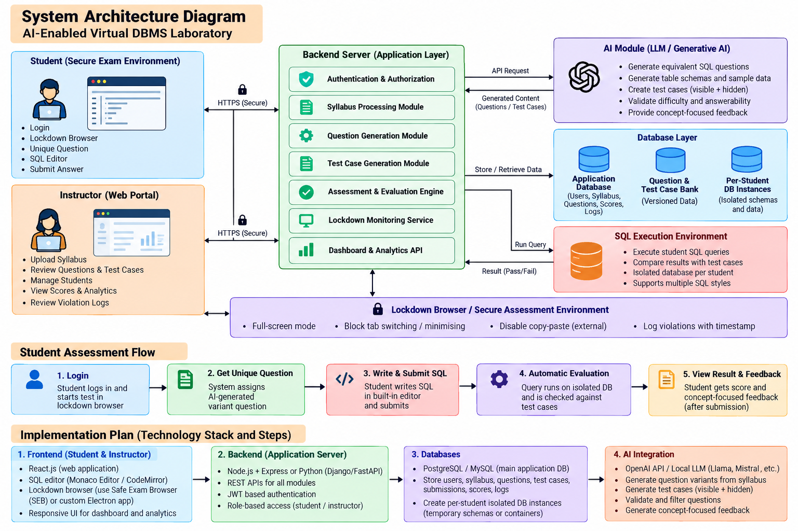

# AI-Enabled Virtual DBMS Laboratory

A secure, syllabus-aligned platform for **fair and automated SQL assessment**.
The instructor uploads the syllabus; the platform generates **equivalent but different** SQL questions for every student,
checks answers by **actually running them** against AI-prepared, teacher-approved test cases, and (for assessments) keeps
students inside a **lockdown browser** until they finish.



---

## 1. What you get

| Part | What it does |
|---|---|
| **Instructor web portal** (`/instructor`) | Upload syllabus · create sessions (**Normal class** or **Assessment**) · generate & review questions/test cases · broadcast the session URL · live monitor · review/override scores · analytics, metrics, CSV export · sees only **how many students** are registered |
| **Student session page** (`/s/<code>`) | **Register on this page** (scan the QR / open the URL) → (assessment: lockdown gate) → unique question per topic → SQL editor → private database → *Run & test* (shows test cases successful / failed) → submit → result pop-up inside the window |
| **Backend** (Node.js + Express, REST + JWT) | Authentication & role-based access, syllabus processing, question & test-case generation, assessment/evaluation engine, lockdown monitoring service, dashboard & analytics API |
| **AI module** | Built-in offline engine (default) **or** any LLM (OpenAI, Llama/Mistral through Ollama, LM Studio…) with automatic fallback |
| **SQL execution environment** | Isolated in-memory SQLite databases (sql.js/WebAssembly) in killable worker threads: one private database instance per student per question, fresh isolated databases for every test case |
| **Lockdown Browser** (`lockdown-browser/`) | Electron kiosk app: full screen, always on top, no tab switching, blocked shortcuts, no outside paste, violation reporting. A browser-based lockdown layer also exists for any normal browser |

---

## 2. Quick start

**Prerequisite:** Node.js 18 or newer (22 recommended). Internet is only needed for `npm install`.

```bash
unzip dbms-lab.zip && cd dbms-lab
npm install
npm start
```

Open **http://localhost:3000/instructor** and log in:

| Role | Username | Password |
|---|---|---|
| Instructor | `instructor` | `instructor123` (change with `INSTRUCTOR_PASSWORD`) |

**There are no student accounts to create.** Students register themselves, only from the session page (by scanning the QR code or opening the session URL) with their name, roll number and a password. The instructor never adds or edits students; the dashboard only shows **how many students are registered** (top bar) and who joined each session (needed for the live monitor).

The console prints the LAN address (e.g. `http://192.168.1.20:3000/`). That is the address the lab computers use.

### Try the whole flow in 5 minutes

1. **Syllabus** tab → *Load sample syllabus* → *Process syllabus* (15 topics are detected; edit them if you like).
2. **Sessions** → *New session* → choose **Normal class** or **Assessment** → *Create session*.
3. Click **⚙ Generate question bank** (e.g. 6 variants per topic). Takes a few seconds.
4. In **Questions & test cases** review a few variants (open one: question, reference solution, visible/hidden test cases, validation), then **✔ Approve all pending**.
5. Click **📡 Broadcast session** and **📺 Show for the lab room** (big URL + QR code + short code).
6. Open the URL on another browser/computer, **register** (name, roll number, password) and answer the questions. Use *▶ Run & test* to see whether the sample test cases are successful or failed, then *Submit answer*.
7. Watch the **Live monitor** and **Violation log**, review flagged answers in **Submissions & review**, then **■ End session** and open **Analytics & metrics**.

---

## 3. How a session works

```
Instructor                                   Student
──────────                                   ───────
Upload syllabus ─▶ topics/concepts/levels
Create session  (Normal class | Assessment)
Generate bank   ─▶ AI variants + test cases (pending)
Review/approve  ─▶ only approved items go live
Broadcast       ─▶ unique URL  /s/<code>  becomes active ─▶  opens URL in the lab
                                                             Register / log in on the page (assessment: lockdown gate)
                                                             Gets ONE unique, approved question per topic
                                                             Writes SQL, Run & test (private DB + sample tests), Submit
Live monitor / violations ◀────────────────────────────────  Automatic evaluation on isolated test DBs
Review flagged, override scores ─▶                           Score + concept-focused feedback
End session ─▶ unsubmitted tests auto-submitted              (after submission)
```

### Normal class vs Assessment (chosen per session by the instructor)

| | **Normal class** | **Assessment** |
|---|---|---|
| Lockdown / safe browser | **off** (any browser) | **on** (full screen, no tab switching, no outside paste, logged violations) |
| Topics, unique questions, hidden test cases, automatic evaluation, feedback | ✅ same | ✅ same |
| Attempts per question | unlimited (default) | 1 (default, editable) |
| Score & feedback shown | right after each submission (default) | after the student submits the test (default, editable) |
| Violation policy (auto-pause / auto-submit) | – | configurable |
| Time limit | optional | optional (default 60 min in the form) |

### Run, test cases and submit (student side)
* **▶ Run & test** executes the query in the student's private database and checks it against the **sample test cases**: every test is listed as **Successful ✔ / Failed ✖** (with expected vs your output and the reason). Hidden tests run on submit.
* **Submit answer** asks for confirmation in an **in-page dialog**, then shows a **result pop-up inside the same window** listing every test case (sample and hidden) as successful/failed. In an assessment the score, feedback and any data stay hidden until the test is finished (unless the instructor chose "show right after each submission").
* No native browser dialogs (`confirm/alert`) are used on the student page, so submitting never leaves full screen and is **never counted as a violation**. The secure window is released **only after the final "Submit test"** (or when the instructor ends the session / policy auto-submits).

### The session URL
* Every session gets its **own generated URL** `http://<server>:3000/s/<code>` and a QR code.
* The URL is **inactive until the instructor presses Broadcast** (students see "waiting for the instructor…" and the page opens automatically when it goes live).
* **📺 Show for the lab room** displays the URL, session code and a large QR code for the projector.
* After **End session** the URL only lets students look at their results.

---

## 4. Features ↔ synopsis traceability

| Synopsis item | Implementation |
|---|---|
| 2.1 Syllabus upload & learning-objective layer | `services/syllabusProcessor.js` – `.txt .md .csv .pdf .docx` or pasted text → topics, SQL concepts, difficulty, learning objectives; editable in the dashboard; single source for all questions/test cases |
| 2.2 Equivalent question variant generator | `services/generator.js` – 15 concept templates × 6 schema themes × randomised data/thresholds/wording. Same concept & difficulty, different wording, table names and data per student. **Each variant is validated** for answerability and difficulty (`services/validator.js`) |
| 2.3 AI test cases + teacher review | Every question gets visible + hidden test cases (defaults 2 + 3). All start **pending**; the instructor approves/rejects/edits each question and test case, adds AI or custom test cases. Only approved items are used |
| 2.4 Secure lockdown browser (assessment only) | `public/js/lockdown.js` (any browser) + `lockdown-browser/` (Electron). Blocks tab switch/minimise/alt-tab detection, outside paste, shortcuts, navigation; logs with timestamps; dashboard flags; auto-pause / auto-submit by instructor policy |
| 2.5 SQL execution & automated evaluation | `services/sqlRunner.js`, `sqlWorker.js`, `evaluator.js` – queries are **executed**; results compared by behaviour (column count, row multiset, order only when required) so different valid SQL styles get credit |
| 2.6 Dual evaluation – AI and teacher | AI scores first and writes concept-focused feedback (no hidden data / solution revealed). Borderline, timeout, "passes samples only", or violation-affected answers are **flagged**; the instructor can override any score |
| 2.7 Instructor dashboard | Syllabus, question/test-case review, live monitor, submissions, analytics (scores, common errors), violation log, CSV export |
| Workflow: Student assessment flow (login → unique question → write & submit → automatic evaluation → result & feedback) | `public/js/student.js`, `routes/play.js` |
| Architecture: Authentication & Authorization | JWT, bcrypt, role-based access (student / instructor) |
| Architecture: Per-student DB instances (isolated schemas and data) | one private sql.js database per student per question (`data/student_dbs/…`), fresh isolated DBs per test case |
| Architecture: Question & Test Case Bank (versioned data) | `questions`, `question_versions`, `test_cases` tables; every edit creates a new version |
| Architecture: Application database (users, syllabus, questions, scores, logs) | `data/app.sqlite` |
| Section 4 performance metrics | `services/analytics.js` – see §8 |
| Section 3 objectives 1-4 | unique equivalent questions · AI + teacher-approved test cases · locked browser · instructor dashboard |

---

## 5. Lockdown (assessment sessions only)

Class sessions never use lockdown. For assessments there are two layers:

**A. Browser lockdown (works in Chrome/Edge/Firefox, enabled automatically for assessments)**
* Student must click *start* → the page enters **full-screen**; leaving it shows a blocking overlay and logs a violation.
* **Tab switch / minimise / window blur** are detected (Page Visibility + blur) and logged with a timestamp.
* **Paste is limited to text copied from inside the editor**; text from outside is blocked and logged. Drag & drop, right-click, select-all of page text, print, F5/F12, Ctrl+R/U/S/P/T/N/W/…, Alt+←/→, back button are blocked/trapped; unload shows a confirmation.
* Dev-tools heuristic (docked dev tools) is reported.
* Every serious event goes to the **violation log** and the **Live monitor**. The instructor policy decides: *warn* → *auto-pause after N* → *auto-submit after M* (defaults 3 / 6). Paused students can be resumed (or force-submitted) from the monitor.

**B. Electron Lockdown Browser (recommended for real exams – OS-level)**
```bash
cd lockdown-browser
npm install            # downloads Electron once
npm start -- http://192.168.1.20:3000/s/<code>      # or run without a URL and type it in the launcher
```
Kiosk mode, always on top, no menu/dev tools, only the lab server origin may be loaded, key combos blocked, clipboard cleared on focus loss, screen-capture protection, second-display detection, focus loss / full-screen exit are logged. The window **cannot be closed** until the test is submitted or the instructor ends the session.
To make assessments **require** it, start the server with `LOCKDOWN_STRICT=true` (and the same `LOCKDOWN_SECRET` on both sides): normal browsers then get "Open this link in the DBMS Lab Lockdown Browser".
Package it for lab PCs with `npm run package` (electron-packager).

> **Honest limits:** a web page cannot truly stop OS-level actions (e.g. Alt+Tab, Win key, a second device). The browser layer *detects and records* them; the Electron app blocks most of them. Use the Electron app plus invigilation for high-stakes exams. The Electron app is provided as source and was not run in the test environment (it has no display); the web layer and the server side are covered by automated tests.

---

## 6. AI module

* **Default (`AI_PROVIDER=none`)** – the built-in generator creates and validates questions and test cases fully offline. No key, no internet.
* **LLM mode** – set in `.env` / environment:

```bash
# OpenAI
AI_PROVIDER=openai AI_API_KEY=sk-... AI_MODEL=gpt-4o-mini npm start
# Local LLM (Llama, Mistral, …) through Ollama
AI_PROVIDER=openai AI_BASE_URL=http://localhost:11434/v1 AI_API_KEY=ollama AI_MODEL=llama3.1 npm start
```
The LLM invents the schema, question text, reference solution and datasets; **everything is passed through the same validator** (reference must run on every dataset, answer must be meaningful and not constant, difficulty is estimated). Rejected or failed answers silently fall back to the template engine. The LLM can also phrase the feedback (`AI_LLM_FEEDBACK=true`); it only sees the question, the student's SQL and a pass/fail summary – never hidden data or the solution.
Question variants made by an LLM are marked 🤖 in the review table. *(The LLM path needs your own key/model; it was not exercised against a live LLM in the test environment, the offline engine was.)*

### How equivalent variants are made
Each topic's concepts are mapped to templates (`select_where`, `order_limit`, `pattern`, `aggregate`, `group_by_having`, `join_inner`, `join_left`, `subquery`, `exists_correlated`, `set_ops`, `window`, `case_expr`, `dml`, `view`, `ddl_create`). All variants of one topic slot use the **same template (same concept & difficulty)**; theme (company, university, retail, hospital, library, logistics), table/column names, data, thresholds and wording differ. A uniqueness check guarantees no two stored questions have identical text, and each question is handed to **one student only**.

### Test cases
Every question has several datasets (same schema, different data). Visible ones are shown after submission; hidden ones only report pass/fail. Expected results are produced by running the reference solution. Hidden tests defeat hard-coded answers: passing the samples but failing hidden tests is flagged as possible hard-coding.

---

## 7. Evaluation, feedback and dual marking

1. Student SQL runs on **each approved test dataset in its own isolated database** (5 s timeout; `ATTACH` blocked).
2. Result sets are compared by behaviour – column count, rows as a multiset (or in order when the question demands it). For INSERT/UPDATE/DELETE/CREATE VIEW/CREATE TABLE questions a *check query* inspects the resulting state.
3. Score = weighted share of passed test cases.
4. Feedback is concept-focused (e.g. *"Revisit LEFT JOIN: unmatched rows keep NULLs…"*) and never leaks hidden data or the solution.
5. **Flagged for the teacher:** borderline scores, timeouts, passes-samples-only, answers from students with lockdown violations. The teacher opens the submission, sees SQL, reference, per-test outputs and feedback, then **overrides or confirms** the score (with a comment shown to the student). Final score = teacher score if present, otherwise AI score.
6. Students who are still working when the test ends (time up / instructor ends / policy auto-submit) have their **saved draft graded automatically**.

---

## 8. Performance evaluation metrics (dashboard → *Analytics & metrics* and *Metrics*)

| # | Criterion | How it is measured here |
|---|---|---|
| 1 | SQL grading accuracy | % of teacher-reviewed submissions where \|AI score − teacher score\| ≤ 10, plus mean absolute difference |
| 2 | Test-case effectiveness | (a) % of teacher-confirmed wrong answers detected by the tests; (b) **mutation score** – the button *Run test-case effectiveness check* injects typical mistakes (`>` vs `>=`, `JOIN` type, `ASC/DESC`, off-by-one `LIMIT`, missing `WHERE`…) into each reference query and reports how many the test cases catch (survivors are listed per question in the DB) |
| 3 | Question equivalence / fairness | teacher star rating per variant (1–5), variant count, structural-complexity spread and score standard deviation per question slot |
| 4 | Evaluation time reduction | estimated manual marking minutes (`MANUAL_EVAL_MINUTES`, default 4/answer) vs measured automatic time + teacher review minutes (`REVIEW_MINUTES`) |

---

## 9. Configuration (environment variables)

See `.env.example` for the commented list. Most useful:

| Variable | Default | Meaning |
|---|---|---|
| `PORT` | 3000 | HTTP port |
| `PUBLIC_BASE_URL` | auto (LAN IP) | base used for the generated session URLs |
| `INSTRUCTOR_USERNAME` / `INSTRUCTOR_PASSWORD` | instructor / instructor123 | first instructor account (created once) |
| `SEED_DEMO_STUDENTS` | false | optional: creates `student01..08` / `student123` for quick demos (normally not needed) |
| `ALLOW_STUDENT_REGISTRATION` | true | registration from the session page (set false to block new students) |
| `LOCKDOWN_STRICT`, `LOCKDOWN_SECRET` | false, … | require the Electron lockdown browser for assessments |
| `AI_PROVIDER`, `AI_API_KEY`, `AI_MODEL`, `AI_BASE_URL` | none | AI module (see §6) |
| `VISIBLE_TESTCASES`, `HIDDEN_TESTCASES` | 2, 3 | test cases per generated question |
| `SQL_TIMEOUT_MS`, `SQL_WORKERS` | 5000, 2 | SQL runner |
| `DATA_DIR` | `./data` | database + per-student sandboxes + JWT secret |

---

## 10. Running it in a lab room

1. Put the server PC and students on the same network. Start with `npm start`; note the LAN address printed in the console.
2. Allow inbound TCP **3000** in the server PC's firewall (Windows: *Allow an app through firewall* → Node.js).
3. Instructor dashboard on the server PC: `http://localhost:3000/instructor`.
4. After **Broadcast**, show the **📺 lab-room screen** (URL + QR). Students open it on their PCs (or in the lockdown browser for assessments).
5. If the printed IP is wrong (VPN, several adapters) set `PUBLIC_BASE_URL=http://<correct-ip>:3000`.
6. Back up `data/` (SQLite files) after the exam if you want to keep records.

Docker alternative: `docker compose up --build` (data is kept in a volume).

---

## 11. Project structure

```
dbms-lab/
├── server/
│   ├── index.js              Express app, static files, routes
│   ├── config.js  db.js  auth.js
│   ├── routes/
│   │   ├── auth.js           login, register, student management
│   │   ├── instructor.js     syllabus, sessions, question/test review, monitor, review, analytics
│   │   └── play.js           student side: join, run, submit, violation, results
│   └── services/
│       ├── syllabusProcessor.js   Syllabus Processing Module
│       ├── generator.js           Question variant + test case generator (offline engine)
│       ├── aiClient.js            LLM client (OpenAI-compatible)
│       ├── bank.js                question bank orchestration, versions, regenerate, custom tests
│       ├── validator.js           answerability + difficulty validation
│       ├── sqlRunner.js / sqlWorker.js   SQL execution environment (worker threads, per-student DBs)
│       ├── compare.js evaluator.js feedback.js   Assessment & Evaluation Engine
│       ├── sessions.js            session lifecycle, lockdown monitoring service, submissions
│       └── analytics.js           Dashboard & Analytics API, performance metrics
├── public/                   React (UMD + htm, no build step) front end
│   ├── index.html  instructor.html  student.html
│   ├── js/common.js instructor.js student.js lockdown.js
│   └── css/style.css
├── lockdown-browser/         Electron safe exam browser
├── samples/                  sample syllabi (pipe format + free text)
├── tests/                    smoke.js (API, 76 checks) · ui-smoke.js (UI, jsdom)
├── docs/architecture-diagram.png
├── Dockerfile  docker-compose.yml  .env.example
└── data/                     created at runtime (app.sqlite, student_dbs/, .jwt_secret)
```

### Data model (SQLite, `data/app.sqlite`)
`users` · `syllabi` · `topics` · `sessions` (mode, token, status, policy, attempts, timing) · `questions` (+ `question_versions`) · `test_cases` · `participants` · `submissions` (AI score, teacher score, flags, feedback) · `violations` · `drafts`.

### Main REST endpoints
| Area | Endpoints |
|---|---|
| Auth | `POST /api/auth/login` · `POST /api/auth/register` · `GET /api/auth/me` |
| Students | `POST /api/auth/register` (needs a live session code) · `GET /api/students/count` (instructor: count only) |
| Syllabus | `POST /api/syllabi` (file or text) · `GET /api/syllabi/:id` · `PUT /api/syllabi/:id/topics` |
| Sessions | `POST /api/sessions` · `GET /api/sessions/:id` · `POST …/generate` · `POST …/broadcast` · `POST …/end` |
| Review | `GET /api/sessions/:id/questions` · `GET/PUT /api/questions/:id` · `POST /api/questions/:id/(approve|reject|regenerate|testcases)` · `PATCH /api/testcases/:id` |
| Monitor | `GET /api/sessions/:id/monitor` · `GET …/violations` · `POST …/participants/:uid/(pause|resume|submit)` |
| Marking | `GET /api/sessions/:id/submissions` · `PUT /api/submissions/:id/review` |
| Analytics | `GET /api/sessions/:id/analytics` · `GET /api/analytics/overview` · `GET /api/sessions/:id/export.csv` |
| Student | `GET /api/public/session/:code` · `POST /api/play/:code/(join|run|reset|submit|finish|violation)` (`run` also returns the sample test-case results) · `GET /api/play/:code/(state|results)` |

---

## 12. Testing

```bash
npm test          # 76 end-to-end API checks (auth, RBAC, syllabus, generation, review, broadcast, unique questions,
                  # lockdown policy, hidden tests, auto-submit, analytics, class mode …)
npm run test:ui   # renders the instructor and student pages in jsdom and clicks through the main flows
npm run test:all
```
Both use a temporary data directory and do not touch `data/`.

---

## 13. Notes, assumptions and limitations

* **Database engine:** the synopsis suggests PostgreSQL/MySQL. For a zero-setup project the application data and all student/test databases use **SQLite (sql.js)**. Equivalent *behaviour* is graded, so different SQL styles are accepted, but questions are SQLite-dialect. Moving to PostgreSQL/MySQL means replacing `db.js` and the worker in `sqlWorker.js` (temporary schemas/containers per student).
* **Front end:** React is used through its UMD build (served from `node_modules`, no CDN, works offline) with `htm` templates and CodeMirror 5 as SQL editor – no build step. (Monaco can replace CodeMirror.)
* **Security:** passwords are bcrypt-hashed, API access uses signed JWTs (12 h) and roles; student SQL only runs in throw-away in-memory databases inside worker threads with a timeout; students never receive solutions or hidden test data. For use beyond a lab network put the server behind HTTPS (reverse proxy) and set `JWT_SECRET`/`INSTRUCTOR_PASSWORD`.
* **Scale:** designed for a class / lab (tens of concurrent students on one server). The SQL runner pool (`SQL_WORKERS`) can be raised for bigger groups.
* **Lockdown limits:** see §5.
* **Documents:** PDF/DOCX syllabus extraction works for text-based files (scanned PDFs need OCR first).

## 14. Troubleshooting

| Problem | Fix |
|---|---|
| Students cannot open the URL | firewall port 3000, same network, or set `PUBLIC_BASE_URL` |
| "Generate and approve at least one question first" | generate the bank, then approve (every question must be reviewed before it goes live) |
| A student sees "Waiting for your instructor to approve questions" | not enough approved *unassigned* variants for that topic – generate more |
| Student cannot enter full screen | the browser blocked it – click the button again / allow full screen; or use the lockdown browser |
| Forgot instructor password | stop the server, delete `data/app.sqlite` (loses data) or start once with a new `INSTRUCTOR_USERNAME` |
| Port already in use | `PORT=3100 npm start` |

---

## 15. Research context (from the synopsis)

Prior work covers SQL learning tools, automated grading and question generation individually. The contribution of this project is the combination – **equivalent-question generation + teacher-reviewed AI test cases + a locked assessment environment under one fairness model** – and the open research question: *does controlled variation plus a locked browser reduce copying while keeping assessment performance comparable?* The violation logs, teacher ratings, score spread and grading-agreement metrics above are the data to answer it.

Related work: Fowler & Zilles (2021) *Superficial Code-guise*, SIGCSE; Nelson, McGarry & Proud (2023) *Using Oracle Query Plan for Automated Assessment of SQL*, INTED; Wójtowicz & Prill (2025) *Relational Database Courses with CodeRunner in Moodle*, SIGCSE TS; Goodfellow et al. (2026) *AI-assisted generation of SQL comprehension questions*, DataEd'26; Atchariyachanvanich et al. (2019); Abelló et al. (2016); Kleerekoper & Schofield (2018); Brusilovsky et al. (2010).
